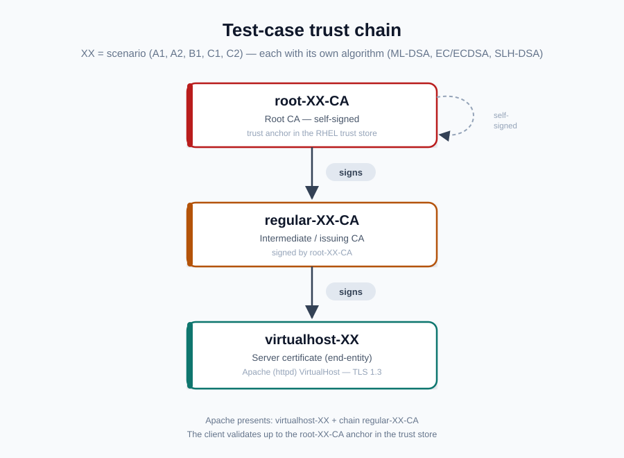

# PQC vs Classical

The following stuff was create to write an article comparing PQC and Classical encryption algorithms.

## Test cases

The following scenarios were selected:

| Test | NIST Cat | Description | KEX | Digital Signature | Virtual Host Port |
|------|----------|-------------|-----|-------------------|-------------------|
| A.1  | 3 | PQC Enterprise DSA | X25519MLKEM768 | ML-DSA-65 | 10443 |
| A.2  | ~3 | Classical Enterprise ECDSA | NIST P-384 | ECDSA+SHA384 | 8443 |
| B.1  | 3 | PQC Enterprise FIPS 205 | X25519MLKEM768 | SLH-DSA-SHA2-192s | 11443 |
| B.2 = A.2 | ~3 | Classical Enterprise ~FIPS 205 | NIST P-384 | ECDSA P-384 | 8443 |
| C.1  | 5 | PQC CNSA 2.0 | ML-KEM-1024 | ML-DSA-87 | 12443 |
| C.2 | 5 | Classical CNSA 2.0 | NIST P-521 | ECDSA+SHA512 | 9443 |

In the TLS 1.3 communication several algorithms are being used:

1. **KEX**, to share the secret key.
2. **Digital Signature**, server autenticatión.
3. **Authenticated Symmetric Cipher (AEAD)**, data encryption and data integrity.
4. **Hash**, key derivation and key integrity.

As we are evaluating **1.** and **2.** options we will force the **3.** and **4.** options to be certain that the only changes are performed in **1.** and **2.** and the algorithm election for **3.** and **4.** options does not add "noise".

For the **3.** option we have several options:

* **TLS_AES_128_GCM_SHA256** -> NIST Category 1 (AES-128).
* **TLS_AES_256_GCM_SHA384** -> NIST Category 5 (AES-256).
* **TLS_CHACHA20_POLY1305_SHA256** -> NIST Category 5 due to key size (256 bits), but using SHA-256.
* **TLS_AES_128_CCM_SHA256 / ..._CCM_8_...** -> NIST Category 1 (IoT and constrained devices).

As there are no Category 3 or equivalent in TLS we will use **TLS_AES_256_GCM_SHA384** (NIST Category 5 with AES-256 and SHA384) as Cipher in all tests. This election will use SHA384 for the **4.** option.