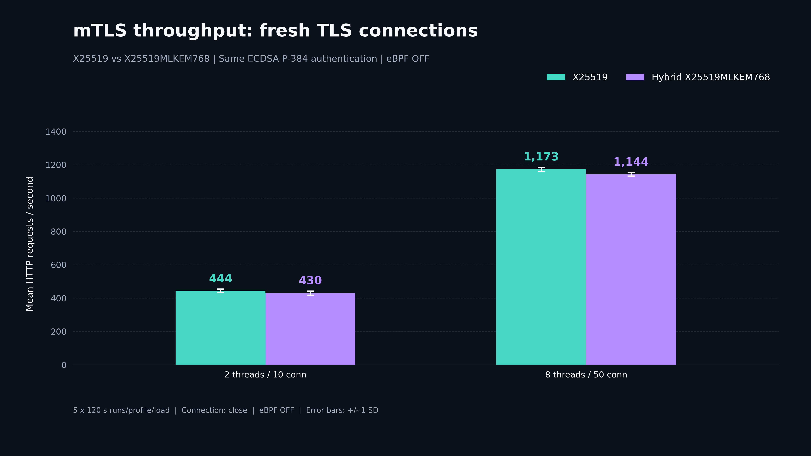
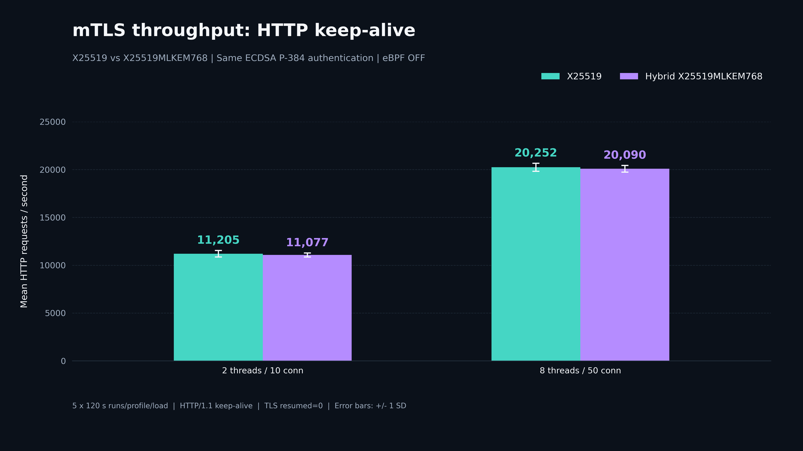
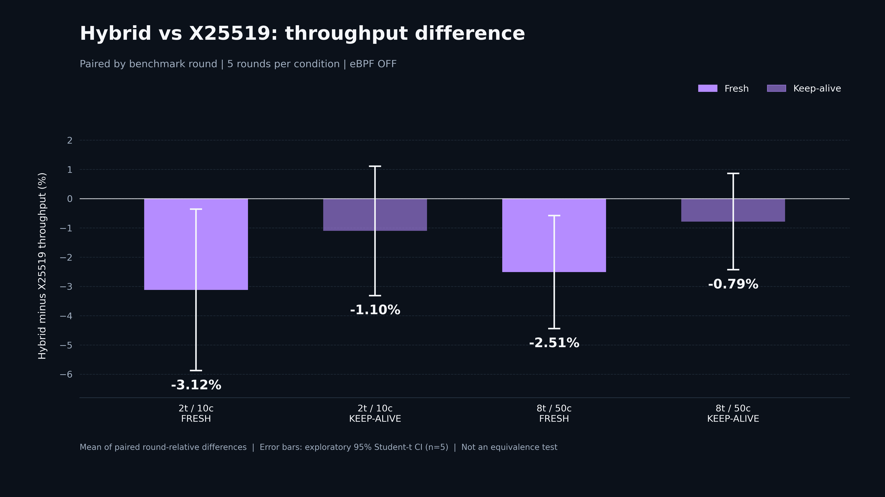
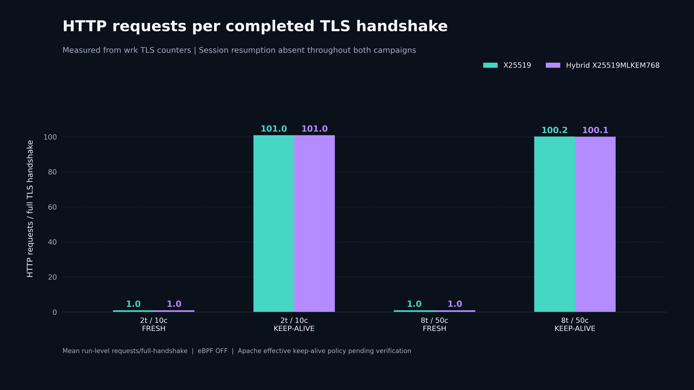
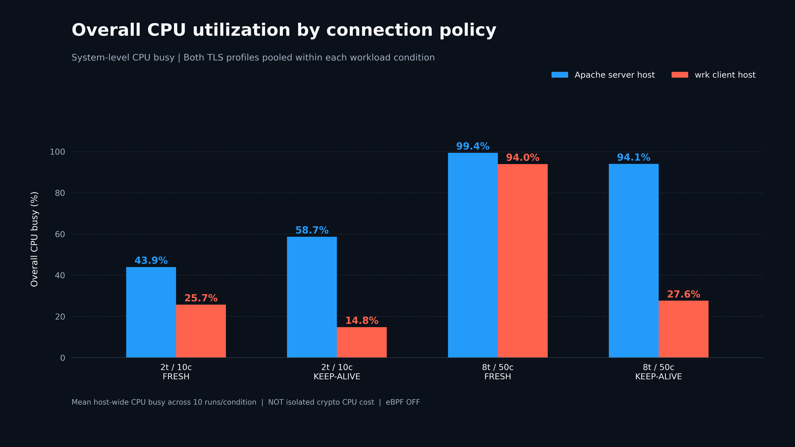
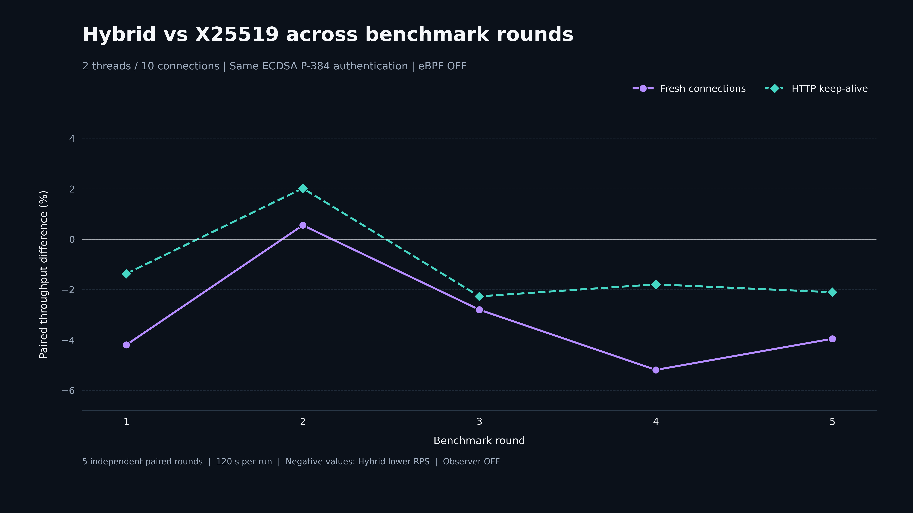
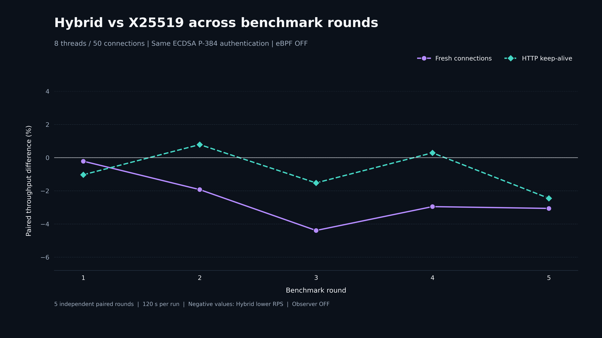

# Post-quantum mTLS: connection reuse and workload saturation

**November 2026 | 40-run reproducible experiment | TLS 1.3 | eBPF OFF**

This study extends the [validated four-profile mTLS campaign](../README.md). It investigates how the **HTTP connection policy** and **offered concurrency** alter *observed application throughput* for two matched TLS key-exchange groups:

- **X25519:** classical key establishment.
- **X25519MLKEM768:** hybrid classical/post-quantum key establishment.

Both configurations use the **same ECDSA P-384 client and server authentication**, the same TLS 1.3 cipher, and the same workload target. Only the key-exchange group differs within each mode and load condition. **This is not a comparison of ML-DSA authentication.**

## Measured throughput (eBPF OFF)

| Concurrency | Connection policy | X25519 mean RPS | Hybrid mean RPS | Hybrid vs X25519 |
|---|---|---:|---:|---:|
| 2 threads / 10 connections | Fresh TLS | 444.33 | 430.43 | **−3.13%** |
| 2 threads / 10 connections | HTTP/1.1 keep-alive | 11,204.62 | 11,077.04 | **−1.14%** |
| 8 threads / 50 connections | Fresh TLS | 1,173.16 | 1,143.58 | **−2.52%** |
| 8 threads / 50 connections | HTTP/1.1 keep-alive | 20,252.22 | 20,090.27 | **−0.80%** |

Each mean represents five independent, 120-second sequential trials in shuffled order. Relative differences above use **ratios of mean RPS**; the 95% CIs shown below use **means of round-paired relative differences**, which are not exactly the same statistical quantity.







### Interpretation

Under repeated fresh TLS connections, hybrid throughput was modestly below X25519 in both load settings. With HTTP keep-alive, the observed gaps were smaller. These are **observed system-level workload effects**, not an isolated measurement of ML-KEM computational cost. Five paired rounds per condition provide exploratory rather than definitive statistical inference; **a confidence interval that crosses zero does not prove equivalence**.

The keep-alive-minus-fresh improvement in the hybrid/X25519 paired relative difference was **+2.01 percentage points** at 2t/10c (exploratory 95% Student *t* CI +0.61 to +3.42 pp) and **+1.72 pp** at 8t/50c (−0.45 to +3.90 pp). An exact two-sided sign-flip check on the five low-load interaction differences gives *p* = 0.0625. We therefore do **not** claim conclusive proof that connection reuse reduces the hybrid penalty in every deployment.

### HTTP connection reuse is not TLS resumption

Fresh mode sends `Connection: close`, resulting in roughly one HTTP request per full handshake. Keep-alive sends multiple requests over the **same** established TLS connection, yielding roughly **100 requests per full handshake** in these tests. All 40 recorded runs had `tls_resumed=0`; no TLS 1.3 PSK session resumption was counted. Some run-level ratios exceed 100 slightly and the effective Apache keep-alive policy remains to be independently checked.



The switch to keep-alive increased total measured throughput approximately 17–26-fold, depending on load. **This is not a 17–26× cryptographic speed-up**: the HTTP workload, rate of new connections, scheduling, socket overhead and saturation conditions also change.

### CPU pressure and run-to-run behavior







With fresh connections at 8t/50c, both the server and client were near their host-wide CPU saturation limit. CPU percentages are measured from `/proc/stat` at the **whole-machine level**; they do not measure crypto-only CPU cost. `wrk` reports HTTP request latency, which excludes TLS setup. Benchmark rounds were sequential, so time drift and workload interference remain possible.

## Reproduce the analysis

The public dataset is deliberately small and contains **40 numeric rows plus two JSON files with non-secret experimental settings**. No TLS keys, certificates, raw logs or internal hostnames are included.

```bash
python3 -m venv .venv
.venv/bin/python -m pip install -r mtls/connection-reuse/requirements.txt
.venv/bin/python mtls/connection-reuse/scripts/analyze.py
```

The script validates the 40-run matrix, zero resumed sessions, the `wrk` SHA-256 recorded in the two metadata files, and nonzero workloads. It regenerates **seven figures** in `figures/dark/` (PNG, SVG and PDF) and three statistical CSVs in `tables/`. Checked-in figures include **PNG and SVG**; PDF outputs are intentionally not committed.

### Reproduce the benchmark

The [sanitized runner](scripts/run-connection-reuse-campaign.py) mirrors the benchmark logic and makes the original internal hostname an explicit command-line option. It requires a separately configured lab with SSH access to the Apache host, verified mTLS credentials, the custom `wrk` TLS-verification build, and an exporter/bpftrace OFF preflight. **The `wrk` binary and certificate private keys are not in this repository.**

Example (substitute your lab hostname):

```bash
python3 mtls/connection-reuse/scripts/run-connection-reuse-campaign.py \
  --server YOUR_APACHE_HOST --web-host YOUR_APACHE_HOST \
  --profiles core --runs 5 --duration 120 --threads 2 --connections 10 --pause 10 --seed 20261120
```

The second campaign used `--threads 8 --connections 50 --seed 20261121`. It ran with the same `wrk` binary, same observer OFF state and same 120-second trial duration. See [methodology](docs/methodology.md) and [technical report](report.md).

## Files

- `data/low-results.csv` and `data/high-results.csv`: **unaltered original run-level numeric observations**, 20 per CSV.
- `data/low-experiment.json` and `data/high-experiment.json`: original campaign configuration and `wrk` checksum.
- `scripts/analyze.py`: offline validation, statistics and full figure rendering.
- `scripts/run-connection-reuse-campaign.py`: sanitized benchmark runner; original private hostname was a default and is now supplied by CLI.
- `tables/`: statistical summaries and round-paired contrasts.
- `figures/dark/`: seven figures in matching original mTLS 16:9 dark theme (`#0B111A`, X25519 teal `#45D6C4`, Hybrid violet `#B58CFF`).
- `docs/methodology.md`: limitations, validation and controls.

**Important:** this extension does not replace or change the preceding mTLS or non-mTLS campaigns; their results should not be pooled without acknowledging different workloads and test assumptions.
