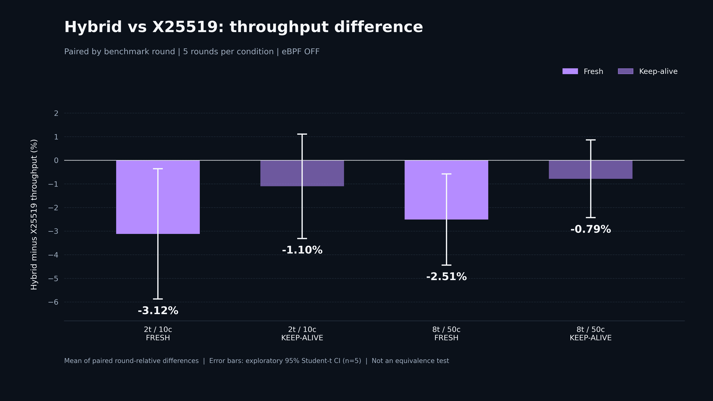
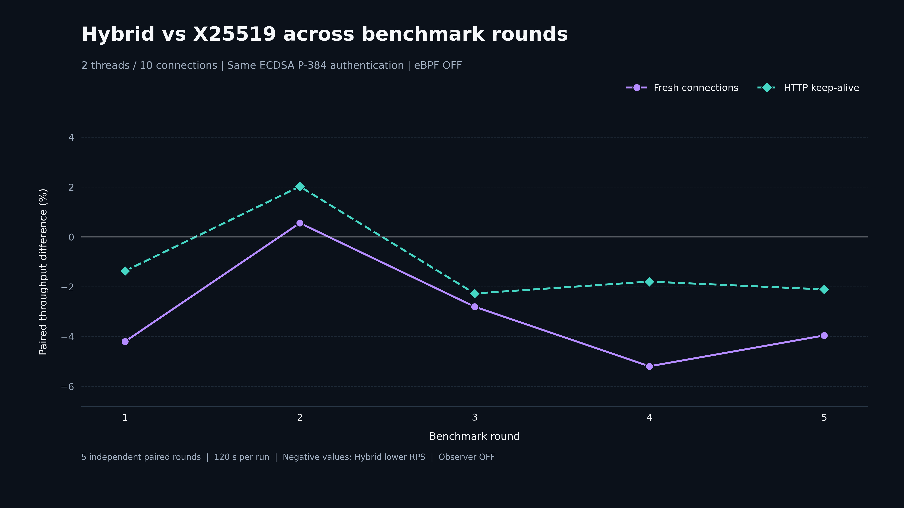
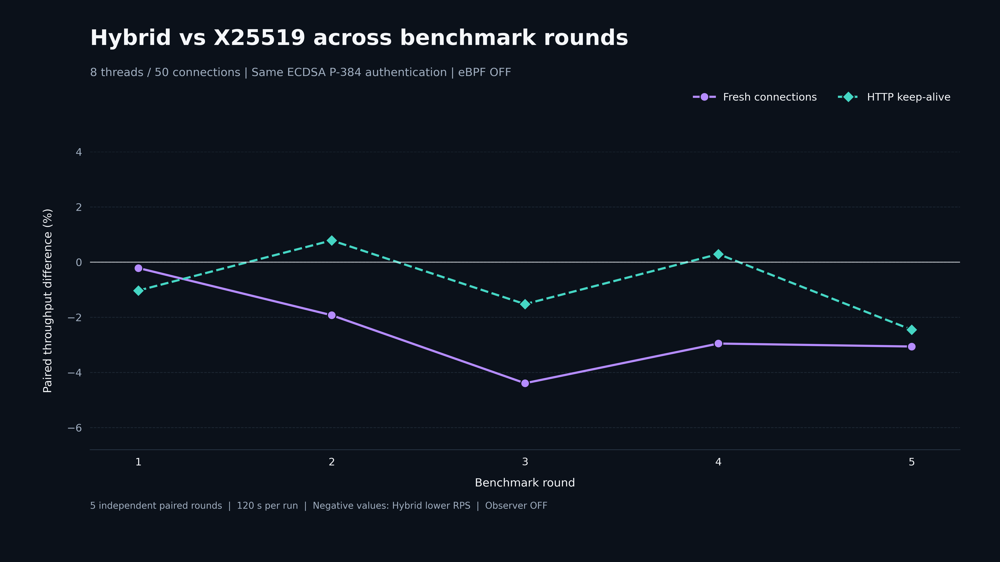
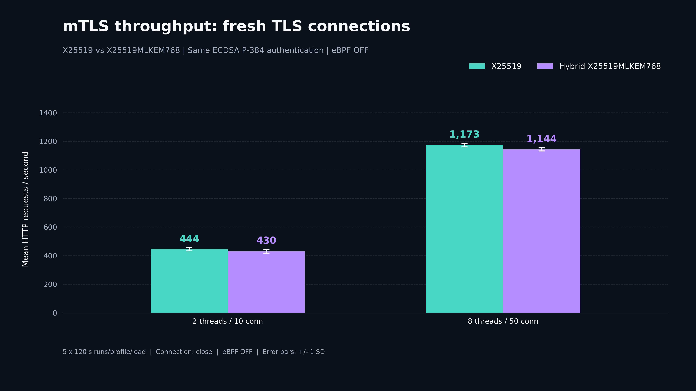
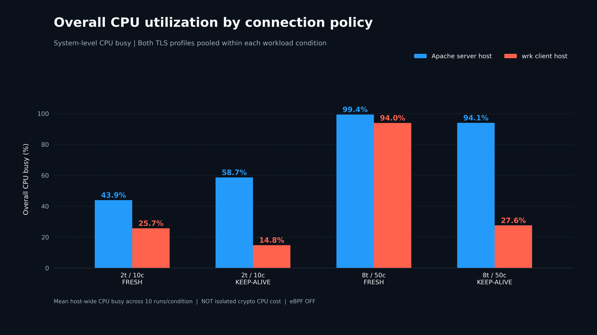

# Technical report: connection reuse in post-quantum mTLS

## Experimental design

Forty runs (5 rounds × 2 key-exchange profiles × 2 HTTP connection policies × 2 concurrency levels), each 120 seconds: **80 minutes** of timed measurements. The two campaigns ran on November 20 and November 22, 2026, with `wrk` configured at 2 threads/10 connections and 8 threads/50 connections respectively. Fresh mode sends `Connection: close`; keep-alive does not. Both compared X25519 with X25519MLKEM768 with the same ECDSA P-384 mTLS authentication profile. TLS session resumption was not used.

## Throughput results

| Concurrency | Policy | X25519 mean RPS | Hybrid mean RPS | Hybrid vs X25519 (ratio of means) | Mean of paired round differences, 95% t CI |
|---|---|---:|---:|---:|---|
| 2t/10c | Fresh | 444.33 | 430.43 | -3.13% | -3.12% [-5.88, -0.36]% |
| 2t/10c | Keep-alive | 11,204.62 | 11,077.04 | -1.14% | -1.10% [-3.31, +1.11]% |
| 8t/50c | Fresh | 1,173.16 | 1,143.58 | -2.52% | -2.51% [-4.44, -0.58]% |
| 8t/50c | Keep-alive | 20,252.22 | 20,090.27 | -0.80% | -0.79% [-2.43, +0.86]% |

The **ratio of mean RPS** and the **mean of five within-round ratios** are different estimands; CIs apply to the latter. The per-round percentage effect is `100*(RPS_hybrid/RPS_x25519 - 1)`.

### Interaction across connection policies

Let `interaction = (hybrid relative difference in keep-alive) - (hybrid relative difference in fresh)` within each round.

| Concurrency | Mean interaction | 95% t interval | Exploratory t p | Two-sided exact sign-flip p |
|---|---:|---|---:|---:|
| 2t/10c | +2.01 percentage points | [+0.61, +3.42] pp | 0.0163 | 0.0625 |
| 8t/50c | +1.72 percentage points | [-0.45, +3.90] pp | 0.0929 | 0.1875 |

The low-concurrency t interval excludes zero, but its exact sign-flip test does not reach the conventional 0.05 threshold; with only five rounds, inference is fragile. At high concurrency the t interval includes zero. None of these results establishes practical equivalence of the two key exchanges. All CIs are unadjusted and exploratory.

### Reuse and resource pressure

Keep-alive/fresh mean HTTP throughput ratios: **25.22×** X25519 and **25.74×** hybrid at 2t/10c; **17.26×** X25519 and **17.57×** hybrid at 8t/50c. Fresh tests averaged ~1 completed request per full handshake. Keep-alive tests averaged ~101 (low concurrency) or ~100 (high concurrency). All `tls_resumed` counts were zero. These throughput multipliers reflect different overall workloads, **not** pure cryptographic speedups.

| Concurrency | Mode | Server CPU X / hybrid | Client CPU X / hybrid |
|---|---|---|---|
| 2t/10c | Fresh | 43.70% / 44.17% | 25.67% / 25.81% |
| 2t/10c | Keep-alive | 58.27% / 59.14% | 14.86% / 14.78% |
| 8t/50c | Fresh | 99.39% / 99.40% | 93.58% / 94.37% |
| 8t/50c | Keep-alive | 94.02% / 94.11% | 27.36% / 27.85% |

The five-run averages **do not reproduce** the much larger low-concurrency server-CPU difference previously seen in a single pilot: just +0.47 percentage points for hybrid in fresh mode. The high-concurrency fresh scenario nearly saturated both server and client. CPU is computed from overall `/proc/stat` busy/idle deltas, not TLS-specific measurements.

## Validations and limitations

- The CSVs contain a complete condition matrix, no missing values, no failed exit codes, and no TLS session resumptions. `experiment.json` records the same SHA-256 for the `wrk` executable in both campaigns.
- The benchmark runner validated TLS 1.3, the group and cipher before accepting runs. However **the uploaded archive contains no raw per-run logs** and therefore cannot independently demonstrate these fields or error status. Retain them before publication.
- `experiment.json` says observer OFF, and the original runner checks observer state before each test. The data alone do not provide a continuous independent instrumentation trace.
- The order was shuffled per round, but each comparison was sequential; temporal drift and other host-level factors remain possible.
- The reported `mean_http_latency_ms` is HTTP response latency, **not end-to-end TLS establishment latency**. Do not use it to claim handshake speed.
- Five rounds per condition justify descriptive exploratory comparisons, not a general statement that all environments see the same penalty. The 95% intervals assume a small-sample t model and do not adjust for testing multiple contrasts.
- Confirm Apache effective `MaxKeepAliveRequests` and related HTTP behavior before explaining values close to 101 requests per handshake.

## Publication-ready paragraph (draft)

> We measured X25519 and hybrid X25519MLKEM768 TLS 1.3 key exchange under matched ECDSA P-384 mutual authentication in two five-round, 120-second campaigns. With fresh HTTP connections, hybrid throughput was 3.13% below X25519 at 2 threads/10 connections and 2.52% below at 8 threads/50 connections. Under HTTP keep-alive, those gaps narrowed to 1.14% and 0.80% respectively. TLS resumption was absent in all recorded runs, while keep-alive handled approximately 100 HTTP requests per full handshake. The data suggest that the measured penalty depends on connection policy, but the small number of sequential rounds and high CPU saturation under one workload limit causal inference. Representative connection behavior, not merely handshake-heavy microbenchmarks, should inform post-quantum TLS evaluations.

## Publication checklist

Archive the per-run logs and runner source; record CPU topology, Apache keep-alive settings and software versions; document certificate verification and negative controls; inspect connection close behavior and response payload sizes. Keep ML-DSA-65 mutual authentication as a separate factor because it also changes the certificate chain and authentication procedure.
